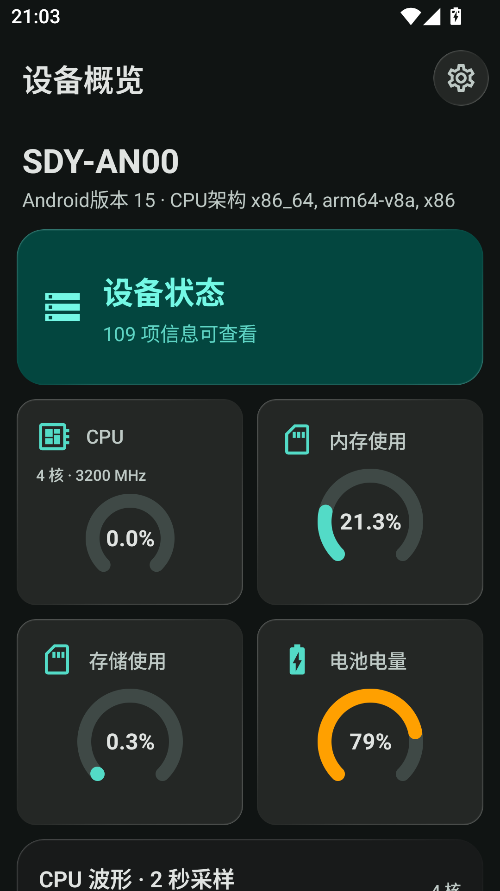
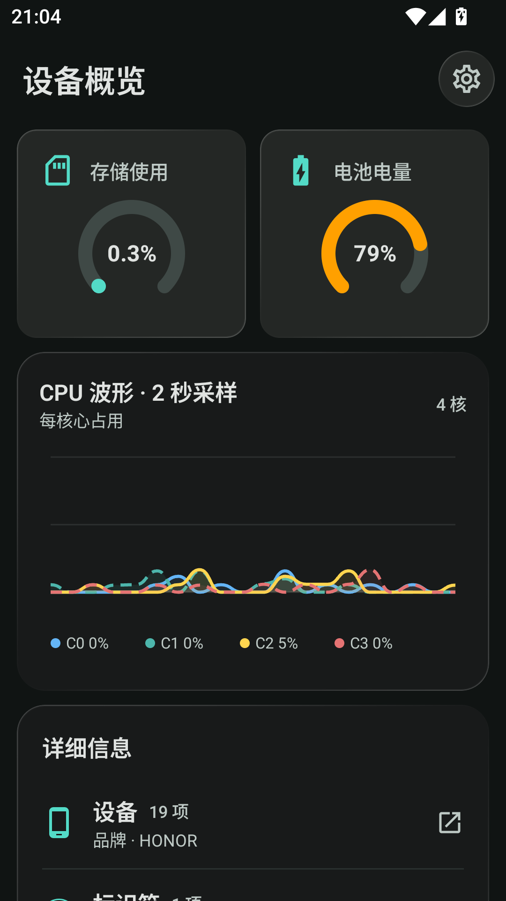
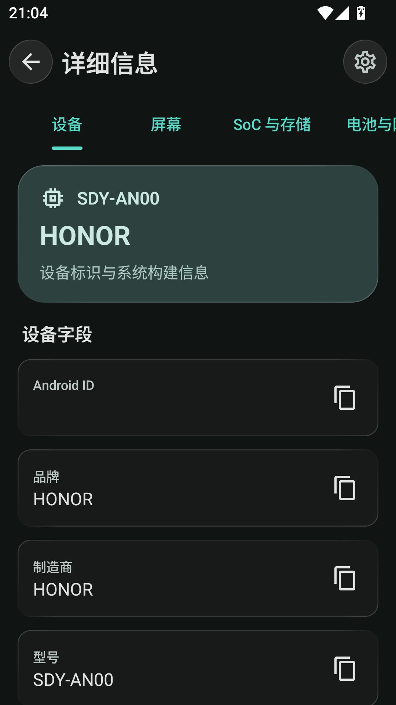

# DevInfo

<p align="center">
  <a href="README.md">简体中文</a> |
  <a href="README.en.md">English</a> |
  <a href="README.ja.md">日本語</a>
</p>

| Device overview | Live metrics and categories | Hardware details |
| --- | --- | --- |
|  |  |  |

[](LICENSE)
[](https://developer.android.com)
[](https://github.com/FIOIU8/DevInfo/releases)

DevInfo is an Android device information viewer built with Kotlin and Jetpack Compose. It collects device data locally, provides a live hardware overview and categorized details, supports theme and language settings, and can export the information as a Magisk/KernelSU ZIP module.

## Features

### Device information and live overview

- Details use seven horizontal pages for device, display, SoC and storage, battery and network, cameras, sensors, and more. Existing fields are preserved and regrouped; select a top tab or swipe horizontally to switch pages.
- Fields include Android version, SDK, ABI, kernel, security patch, display, memory/storage, battery, network, sensors, and app information.
- The camera page shows basic characteristics available to the system without requesting camera permission. The sensor page lists available sensors and reads live accelerometer and gyroscope axes only while that page is visible in the foreground.
- The overview shows the device model and system summary, available field count, circular CPU/memory/storage/battery metrics, a separate CPU graph, and category summaries. It supports pull-to-refresh; GPU, motion, brightness, storage read speed, and Wi-Fi signal appear when supported.
- CPU statistics may be restricted in normal mode. Optional Root mode shows a risk notice first and only requests root permission after you confirm; when it fails, it explains the reason and offers in-app authorization help.

### Export and updates

- Export a ZIP-based Magisk/KernelSU module through the system file picker; the exported content is a fixed minimal set (brand, model, device, product name, Android version/SDK, and ABI lists).
- The module version and versionCode come from the app version. Flashing a module writes ro.product.* system properties and can change system behavior.
- Official builds can check GitHub Releases and show release notes. Network failures are reported as an error state.

### UI and localization

- A unified Material 3 technical dashboard. Details use top category tabs and horizontal paging, with back and settings actions in the top bar; the main screen has no bottom navigation and uses a navigation rail on wide screens. Overview and detail cards, along with top bar actions, use liquid glass surfaces.
- All pages use Material 3. AndroidLiquidGlass provides the liquid-glass effects.
- System, light, dark, and dynamic-color modes with theme colors, palette styles, and page scale settings.
- Simplified Chinese, English, Japanese, and custom BCP-47 locale tags.
- Predictive back gestures on Android 14+, splash screens, and app-wide pull-to-refresh.

## Data availability and privacy

Readable fields depend on the manufacturer, Android version, permission policy, and `/proc`/`/sys` restrictions. Individual failures do not block the rest of the screen, and unavailable CPU utilization is never presented as `0%`.

The app has no custom backend and does not upload device information. Update checks contact the GitHub API; inspect exported ZIP contents before sharing or flashing. Root mode is optional.

The manifest declares `INTERNET`, `ACCESS_NETWORK_STATE`, `ACCESS_WIFI_STATE`, and `NFC`; NFC is an optional device feature. No Bluetooth permission is currently declared.

## Download and build

### Downloads

- Official releases: [Releases](https://github.com/FIOIU8/DevInfo/releases).
- Test builds: download workflow Artifacts from [Actions](https://github.com/FIOIU8/DevInfo/actions).

### Requirements

- Android Studio and Android SDK 37.
- JDK 21; `app`/`feature-main` target JVM 21, while `core`/`data`/`ui` remain on JVM 11.
- Minimum supported Android version: Android 13 (API 33).

### Local build

```bash
# Windows
gradlew.bat testDebugUnitTest
gradlew.bat ktlintCheck
gradlew.bat lintDebug
gradlew.bat assembleDebug

# Linux/macOS: replace gradlew.bat with ./gradlew
```

The debug APK is written to `app/build/outputs/apk/debug/`.

## Technology and structure

| Technology | Current configuration |
| --- | --- |
| Kotlin | 2.4.10 |
| Jetpack Compose | BOM 2026.08.00 |
| Android Gradle Plugin | 9.1.0 |
| compileSdk / targetSdk | 37 |
| minSdk | 33 (Android 13) |
| Java target / toolchain | `app`/`feature-main`: JVM 21; `core`/`data`/`ui`: JVM 11; JDK 21 |

```text
DevInfo/
├── app/                 # Android entry point, manifest, resources, build
├── core/                # Framework-independent models and CPU parsing
├── data/                # Collection, monitoring, preferences, updates, export
├── feature-main/        # Main, overview, details, settings, about
├── ui/                  # Material 3 themes and shared components
├── .github/workflows/   # CI, builds, and releases
├── gradle/libs.versions.toml
└── LICENSE
```

`MainActivity` assembles dependencies. `MainViewModel` coordinates loading, refresh, and foreground monitoring, while screens collect `StateFlow`. Theme and language preferences use SharedPreferences; the update cache uses DataStore with a legacy SharedPreferences compatibility path. Page state is managed by `MainScreen`; Navigation Compose is not used.

## CI and releases

- `build.yml` runs tests, ktlint, Android lint, and builds for pushes to `main`, `dev`, or `test`, pull requests, and manual runs.
- Manual builds accept a version name and `debug`/`release` signing type and upload APK/build information Artifacts.
- `release.yml` supports pushes to `main`, `vMAJOR.MINOR.PATCH` tags, and manual releases from `main`.
- Releases pass tests, ktlint, and lint before using `KEYSTORE_BASE64`, `KEYSTORE_PASSWORD`, `KEY_ALIAS`, and `KEY_PASSWORD` to create a signed APK and Draft Release.

## Contributing

Read the implementation and tests before changing the relevant module, then run the applicable Gradle checks. Commit messages use `English prefix: Chinese description`, for example `docs: 更新开发文档`. Report issues through [Issues](https://github.com/FIOIU8/DevInfo/issues).

## License and links

This project is released under the [MIT License](LICENSE). Third-party components and their licenses are listed in [THIRD-PARTY-NOTICES.md](THIRD-PARTY-NOTICES.md).

License history: releases `v1.0.0`–`v1.3.3` were MIT; `v1.3.4`–`v1.4.3` used GPL-3.0-or-later because of third-party GPL-3.0 code; releases after this change are MIT again. Copies of the GPL-3.0-or-later releases already obtained remain under that license and are unaffected by this change.

- [Source code](https://github.com/FIOIU8/DevInfo)
- [Releases](https://github.com/FIOIU8/DevInfo/releases)
- [Actions](https://github.com/FIOIU8/DevInfo/actions)
