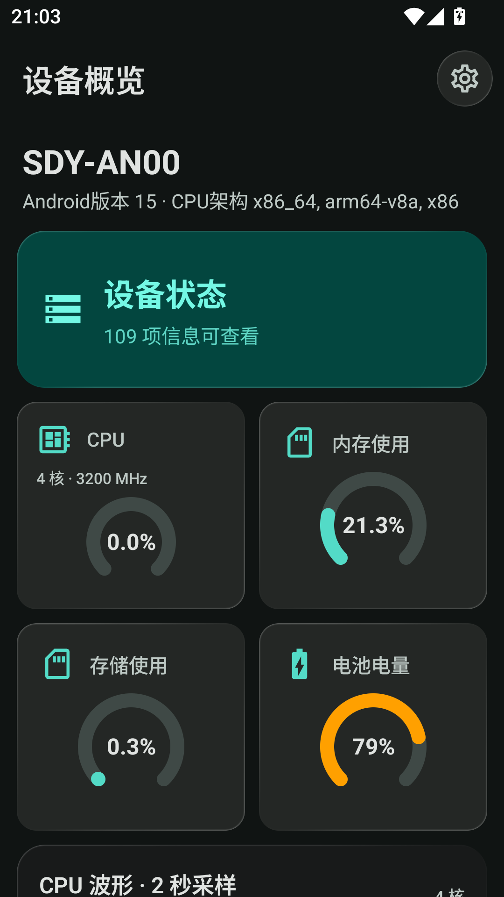
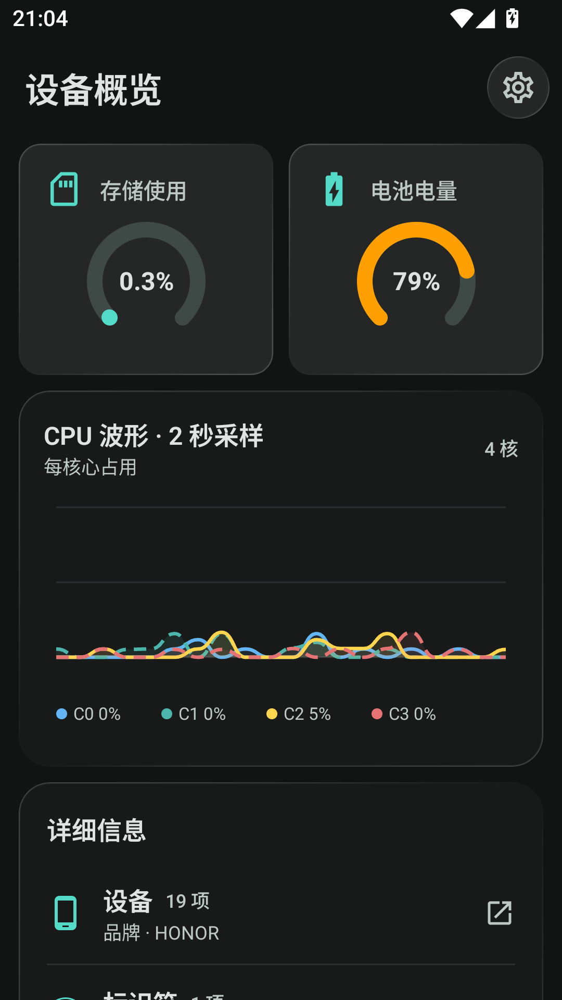
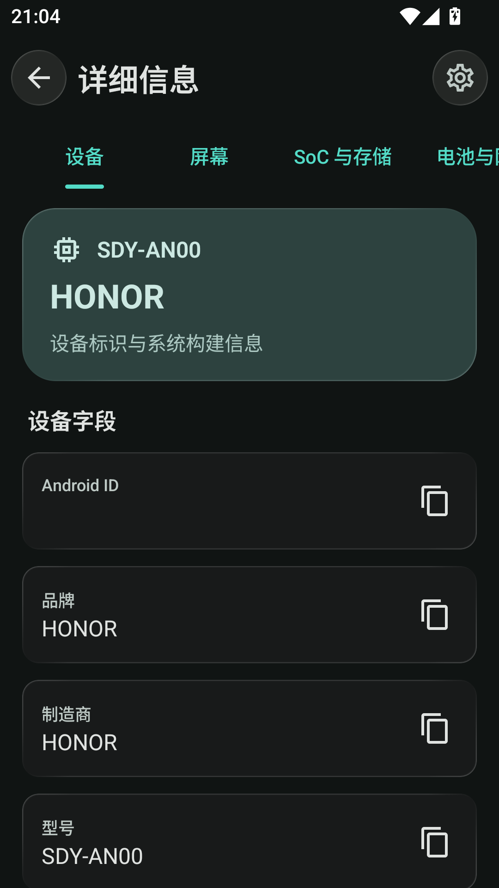

# DevInfo

<p align="center">
  <a href="README.md">简体中文</a> |
  <a href="README.en.md">English</a> |
  <a href="README.ja.md">日本語</a>
</p>

| 设备概览 | 实时指标与分类信息 | 硬件详情 |
| --- | --- | --- |
|  |  |  |

[](LICENSE)
[](https://developer.android.com)
[](https://github.com/FIOIU8/DevInfo/releases)

DevInfo 是一个使用 Kotlin 和 Jetpack Compose 编写的 Android 设备信息查看器。它在本地采集设备信息，提供实时硬件概览、分类详情、主题与语言设置，并可将信息导出为 Magisk/KernelSU ZIP 模块。

## 功能

### 设备信息与实时概览

- 详情页是一个连续滚动列表，按设备、屏幕、SoC 与存储、电池与网络、相机、传感器及更多信息分成七个吸顶分段，保留现有字段并按用途归类；从概览的分类入口进入时会直接滚动到对应分段。
- 覆盖 Android 版本、SDK、ABI、内核、安全补丁、屏幕、内存/存储、电池、网络、传感器和应用信息等字段。
- 相机页展示系统允许读取的相机基础能力，不申请相机权限；传感器页展示传感器清单，并在页面前台可见时读取加速度计和陀螺仪实时三轴数据。
- 总览页显示设备型号与系统摘要、可查看信息项数、CPU/内存/存储/电池圆环指标、独立 CPU 波形及分类摘要，并支持下拉刷新；GPU、运动、亮度、存储读速和 Wi-Fi 信号按设备能力显示。
- 普通模式下 CPU 统计可能受系统限制；可选 Root 模式会先展示风险告知，确认后才向 Root 管理器请求权限，失败时按原因提示并可查看应用内的授权帮助。

### 导出与更新

- 通过系统文件选择器导出 ZIP 格式的 Magisk/KernelSU 模块；导出内容固定为最小集合，仅包含品牌、型号、设备代号、产品名、Android 版本/SDK 与 ABI 列表。
- 模块的 version 与 versionCode 取自应用版本；刷入模块会写入 ro.product.* 等系统属性，可能改变系统行为。
- 正式构建可检查 GitHub Releases 更新并显示发布说明；网络异常会显示失败状态。

### 界面与本地化

- 统一 Material 3 技术仪表盘界面，详情页顶部提供返回和设置入口。主界面不显示底部导航，宽屏使用导航轨；卡片与顶部栏操作默认使用液态玻璃表面。
- 全部页面使用 Material 3 Expressive：页面标题共享元素过渡、内容区大标题、强调型字阶、按压缩放反馈、形状变形加载指示器，以及统一的形状尺度。按压动效可在主题设置中关闭。
- 液态玻璃效果由 AndroidLiquidGlass 提供，并可在主题设置中关闭。Android 12 / 12L 保留背景模糊，透镜折射效果需要 Android 13+。关闭后卡片回退为纯 Material 3 色调表面（容器色与形状不变），界面不残留任何自绘玻璃层。
- 动态颜色模式下，颜色风格（Tonal Spot、Vibrant、Expressive、Fidelity、Content、Neutral、Monochrome、Rainbow、Fruit Salad）与对比度档位会真正参与色板生成。
- 系统、浅色、深色和动态颜色模式，以及主题色、颜色风格和页面缩放设置；设置项统一使用分段式列表。
- 简体中文、英文、日文和自定义 BCP-47 locale 标签。
- Android 14+ 预测返回手势（带进度预览）、Splash 屏和全局下拉刷新。

## 数据可用性与隐私

厂商 ROM、Android 版本、权限策略以及 `/proc`/`/sys` 限制会影响字段可用性。单项采集失败不会阻塞其他信息；不可用的 CPU 使用率不会伪装成 `0%`。

Android ID、序列号、构建指纹/Host/User 以及 OAID/AAID 默认显示为固定长度星号，需要点击眼睛图标主动显示；离开页面、刷新或旋转后重新隐藏。导出 ZIP 不包含这些标识符。

防截屏默认开启（`FLAG_SECURE`）。关闭后，Android 14+ 会检测截图并弹窗列出当前页面上存在风险的字段；Android 13 及以下无法检测截图，界面会明确说明。OAID/AAID 通过 Android_CN_OAID 在本机读取，不发起网络请求；AAID 依赖 GMS 广告标识，因此会发生 `AD_ID` 权限合并。

应用没有自建后端或设备信息上传服务。更新检查访问 GitHub API；导出 ZIP 前请检查敏感字段，分享或刷入前确认风险。Root 模式不是应用运行的必要条件。

Manifest 当前声明 `INTERNET`、`ACCESS_NETWORK_STATE`、`ACCESS_WIFI_STATE`、`NFC`、`DETECT_SCREEN_CAPTURE`，以及 AAID 所需的 GMS `AD_ID`；NFC 特性为非必需。OAID 库自带的电话、存储和系统设置权限已通过 manifest 移除，当前没有蓝牙权限声明。

## 下载与构建

### 下载

- 正式版本：[Releases](https://github.com/FIOIU8/DevInfo/releases)。
- 测试构建：[Actions](https://github.com/FIOIU8/DevInfo/actions) 中下载 workflow Artifact。

### 环境要求

- Android Studio 和 Android SDK 37。
- JDK 21；`app`/`feature-main` 使用 JVM 21，`core`/`data`/`ui` 保持 JVM 11。
- 最低支持 Android 12（API 31）。

### 本地构建

```bash
# Windows
gradlew.bat testDebugUnitTest
gradlew.bat ktlintCheck
gradlew.bat lintDebug
gradlew.bat assembleDebug

# Linux/macOS: replace gradlew.bat with ./gradlew
```

Debug APK 输出在 `app/build/outputs/apk/debug/`。

## 技术栈与结构

| 项目 | 当前配置 |
| --- | --- |
| Kotlin | 2.4.10 |
| Jetpack Compose | BOM 2026.08.00 |
| Android Gradle Plugin | 9.1.0 |
| compileSdk / targetSdk | 37 |
| minSdk | 31（Android 12） |
| Java 编译目标 / 工具链 | `app`/`feature-main`: JVM 21；`core`/`data`/`ui`: JVM 11；JDK 21 |

```text
DevInfo/
├── app/                 # Android 入口、Manifest、资源和构建
├── core/                # 无 UI 的模型与 CPU 解析
├── data/                # 采集、监控、偏好、更新和模块导出
├── feature-main/        # 主界面、总览、详情、设置和关于
├── ui/                  # Material 3 主题与共享组件
├── .github/workflows/   # CI、构建和 Release
├── gradle/libs.versions.toml
└── LICENSE
```

`MainActivity` 组装依赖，`MainViewModel` 协调加载、刷新和前台监控，页面通过 `StateFlow` 收集状态。主题/语言偏好使用 SharedPreferences；更新缓存使用 DataStore，并保留旧 SharedPreferences 兼容路径。页面状态由 `MainScreen` 管理，不使用 Navigation Compose。

## CI 与发布

- `build.yml` 在 `main`、`dev`、`test` 分支 push、目标分支 Pull Request 和手动运行时执行测试、ktlint、Android lint 与构建。
- 手动构建可输入版本名和 `debug`/`release` 签名类型，并上传 APK 与构建信息 Artifact。
- `release.yml` 支持 `main` push、`vMAJOR.MINOR.PATCH` tag 和从 `main` 发起的手动发布。
- Release 流程先通过测试、ktlint 和 lint，再使用 `KEYSTORE_BASE64`、`KEYSTORE_PASSWORD`、`KEY_ALIAS`、`KEY_PASSWORD` 创建签名 APK 和 Draft Release。

## 贡献

请先阅读代码和测试，再修改对应模块，并运行相关 Gradle 检查。提交格式为 `英文前缀: 英文描述`（与 `AGENTS.md` §8 一致），例如 `docs: update contributor instructions`。问题请提交到 [Issues](https://github.com/FIOIU8/DevInfo/issues)。

## 许可证与链接

本项目基于 [MIT](LICENSE) 发布。第三方组件及其许可见 [THIRD-PARTY-NOTICES.md](legal/THIRD-PARTY-NOTICES.md)。

许可沿革：`v1.0.0`–`v1.3.3` 以 MIT 发布；`v1.3.4`–`v1.4.3` 因引入第三方 GPL-3.0 代码改为 GPL-3.0-or-later；自本变更之后的版本恢复 MIT。已按 GPL-3.0-or-later 发布的版本，其既有副本仍适用该协议，不因本次变更而改变。

- [源代码](https://github.com/FIOIU8/DevInfo)
- [Releases](https://github.com/FIOIU8/DevInfo/releases)
- [Actions](https://github.com/FIOIU8/DevInfo/actions)
